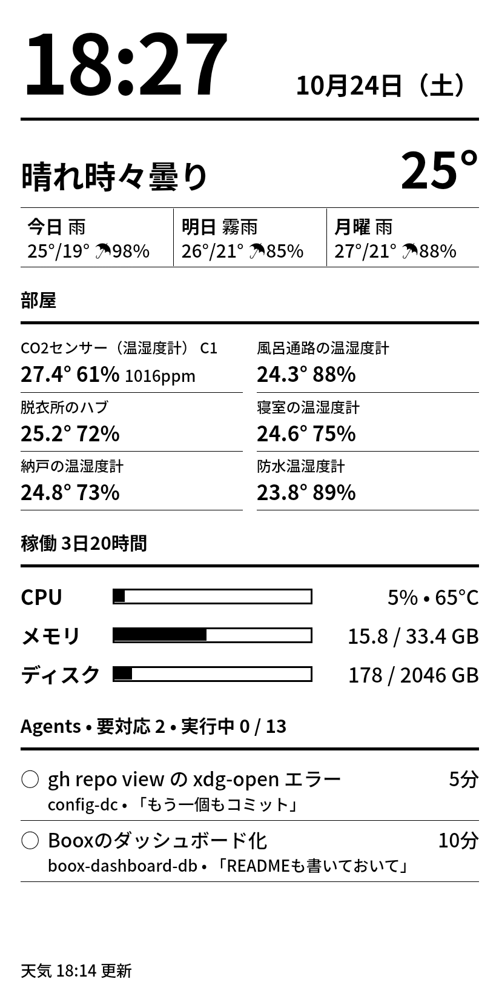

# boox-dashboard

An always-on e-ink dashboard for a [Boox Palma](https://shop.boox.com/products/palma), served from a Linux PC over USB.



The page shows:

- The clock and date
- The weather: current conditions and 3 days of forecast, from [Open-Meteo](https://open-meteo.com/)
- Room temperature, humidity and CO2 from [SwitchBot](https://github.com/OpenWonderLabs/SwitchBotAPI) sensors
- The host PC's CPU, memory and disk usage, CPU temperature and uptime
- [Claude Code](https://claude.com/claude-code) sessions that are waiting for a permission prompt or a reply

The Palma needs no network. It reaches the server through `adb reverse`, takes its clock from the server, and stays awake while plugged in.

## How it works

- `main.go` is a single Go binary. It serves `web/` and a small JSON API on `127.0.0.1:8080`.
- `web/index.html` is a black-on-white page written for the Palma's built-in Chrome 85. To keep e-ink repaints and ghosting low, it writes only the parts that changed, and it refreshes the clock, PC and agents together once a minute.
- `scripts/palma-keeper.sh` polls every 30 seconds. Whenever the Palma (re)connects, it sets up the device: the reverse port, the clock, stay-awake, rotation, then it opens the page full screen.

| Endpoint | Source | Cache |
|---|---|---|
| `/api/weather` | Open-Meteo | 10 min |
| `/api/room` | SwitchBot API v1.1 | 5 min |
| `/api/system` | `/proc`, `statfs`, hwmon | none |
| `/api/agents` | `$CLAUDE_CONFIG_DIR/sessions` and the session transcripts | none |

## Requirements

- Linux (the system stats read `/proc` and hwmon)
- Go 1.27 or later
- `adb` (android-tools)
- A Boox Palma with USB debugging on: Settings → More settings → USB debugging. Accept the authorization prompt on the device when it is first plugged in.

## Setup

Build the server:

```sh
go build -o bin/boox-dashboard .
```

Create `.env` in the repository root. Every key is optional:

```sh
# SwitchBot app → Profile → Preferences: tap App Version 10 times, then open Developer Options.
# Without these, the room section is hidden.
SWITCHBOT_TOKEN=...
SWITCHBOT_SECRET=...
# Weather location. The default is Tokyo.
WEATHER_LAT=35.6812
WEATHER_LON=139.7671
```

Keep `.env` private (`chmod 600 .env`). It is gitignored.

### Run by hand

```sh
set -a; . ./.env; set +a
./bin/boox-dashboard                # add -web web to serve the page from disk, so edits apply on reload
./scripts/palma-keeper.sh           # in another terminal, with the Palma plugged in
```

### Run as systemd user services

The units in `deploy/` assume this checkout lives at `~/local/src/github.com/sixeight/boox-dashboard`. Edit the paths first if it lives elsewhere.

```sh
systemctl --user enable --now "$PWD/deploy/boox-dashboard.service" "$PWD/deploy/palma-keeper.service"
```

After rebuilding the binary, restart the server with `systemctl --user restart boox-dashboard`. The units start at login. To keep them running while logged out, run `loginctl enable-linger`.

## Configuration

| Flag | Default | |
|---|---|---|
| `-addr` | `127.0.0.1:8080` | Listen address |
| `-lat`, `-lon` | `WEATHER_LAT`, `WEATHER_LON`, or Tokyo | Weather location |
| `-web` | embedded copy | Serve the page from this directory instead |

`palma-keeper.sh` reads `PORT` (default `8080`) and `ROTATION` (default `2`). `ROTATION` is `0`, `1`, `2` or `3` for 0, 90, 180 or 270 degrees. The default is upside down, so the cable can stay plugged in while the device stands upright.

`/api/agents` reads `CLAUDE_CONFIG_DIR`, falling back to `~/.claude`.

## Notes

- After the reverse mapping changes, Chrome can keep stale connections to the old mapping. The keeper force-stops Chrome before it reopens the page.
- Chrome allows full screen only after a user gesture. The keeper sends a tap to the center of the screen, which assumes the Palma's 824x1648 display.
